# SingForge

Deploy and manage a single Linux sing-box server from a numbered terminal dashboard or the Cobra CLI. Direct mode provides Reality, Hysteria2 and Shadowsocks. Add a Cloudflare Named Tunnel for WebSocket fallback and HTTPS publication for client subscriptions.

[中文](README.zh-CN.md) · [Releases](https://github.com/howardshaw/singforge/releases) · [CLI](docs/cli.md) · [Operations](docs/operations.md)

## Install with an agent

```text
Read AGENTS.md. Install the latest stable SingForge release on <SSH host> using <private .env path>, including its DNS, Tunnel and HTTPS subscription settings. Preserve existing services and grants. Verify the deployment and privately return working subscription URLs for Mihomo/Clash, Shadowsocks and v2rayN.
```

## Install a release on the VPS

Use Debian 12+ or Ubuntu 22.04+, systemd, sudo/root and Linux amd64 or arm64. The VPS downloads the compiled CLI from GitHub Actions releases. It also needs outbound HTTPS to obtain the verified upstream core.

```sh
VERSION=v0.1.3
BASE="https://github.com/howardshaw/singforge/releases/download/$VERSION"
SETUP=$(mktemp -d)
cd "$SETUP"
for file in install.sh singforge.env.example SHA256SUMS; do
  curl --proto '=https' --proto-redir '=https' -fSL "$BASE/$file" -o "$file" || exit 1
done
sha256sum -c --ignore-missing SHA256SUMS && sudo sh install.sh --release "$VERSION"
sudo install -d -m 700 /root/singforge
sudo install -m 600 singforge.env.example /root/singforge/.env  # fresh host only
sudoedit /root/singforge/.env
```

The installer selects the architecture and checks the binary against the SHA-256 manifest from the same GitHub release. For an existing installation use `sudo singforge self update --yes`.

## Configure the environment file

For **direct IP only**, fill in `PUBLIC_IP` with the VPS public address (use the public mapping on NAT hosts). Leave `DOMAIN` empty and the two feature switches false. Continue to **Apply and connect**.

For **domain-based deployment**, set `DOMAIN` to the active Cloudflare zone and choose a distinct `PREFIX` for each VPS. If Cloudflare already hosts your domain, skip to step 3.

<details>
<summary><strong>1. Find a domain on Spaceship and review checkout</strong></summary>

Open [Spaceship](https://www.spaceship.com/) and search under **Register** for six digits and a candidate suffix. Compare registration and renewal prices for the same digits across suffixes. Of the 54 available offers displayed in this search, `739462.xyz` had the lowest first-year price. Registration and renewal were both listed at CNY 4.47. Availability, currency and prices depend on the live quote.

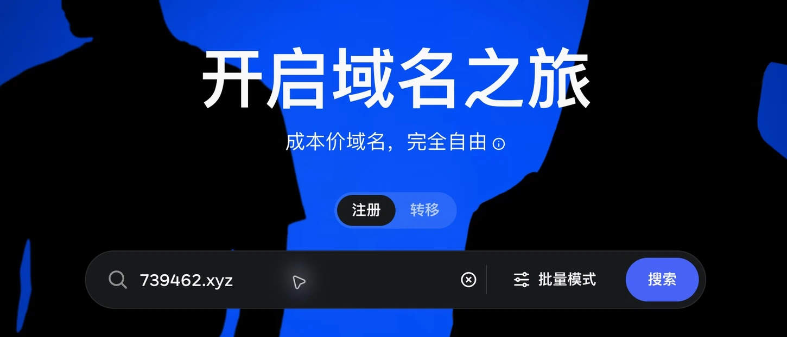
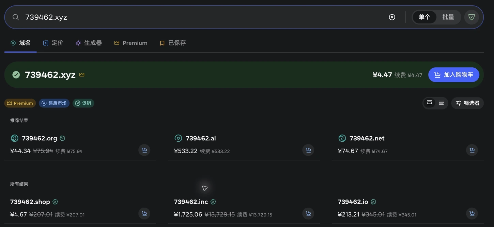

Choose **Add to cart → View cart**. If product recommendations appear, continue to the cart. Keep one year of domain registration and check the fees. This cart added CNY 1.33 in ICANN fees, bringing the total to CNY 5.80. Open **Checkout** to review the payment method and total. **The walkthrough stops at Pay now.** After a successful purchase, the domain appears in your domain manager.

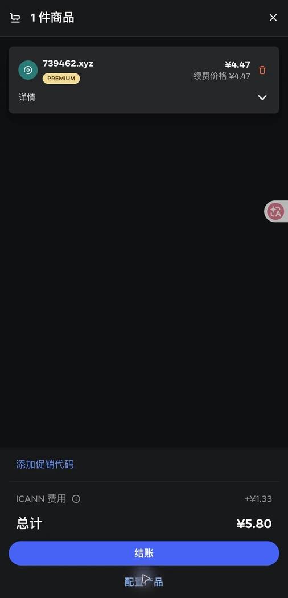 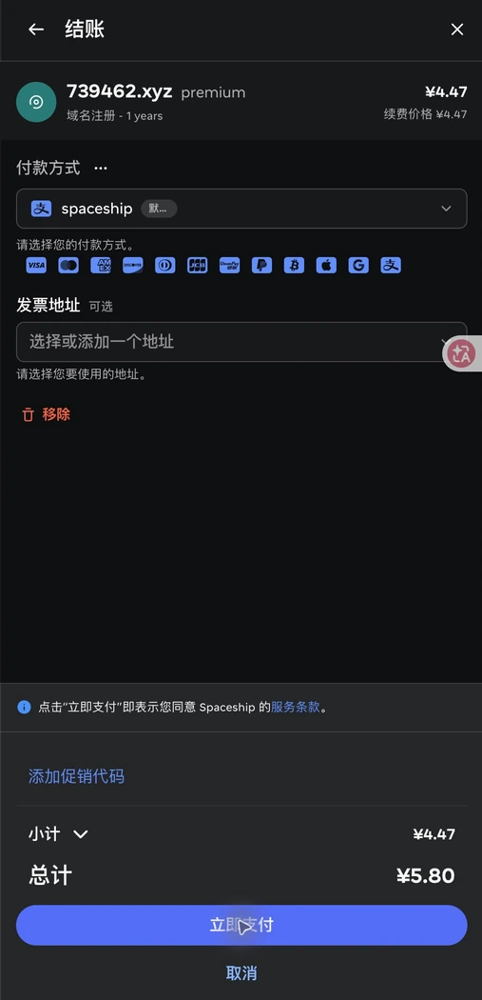

</details>

<details>
<summary><strong>2. Delegate a registered domain to Cloudflare</strong></summary>

1. In Cloudflare, open **Domains → Overview → Add domain → Connect a domain**. Enter the registered root domain, such as `example.org`. Choose automatic DNS record import, continue and select the **Free** plan.
2. Review the imported records against your current DNS provider. Add missing website, mail and verification records, particularly MX and TXT. If DNSSEC is enabled, follow the migration instructions for the existing DS record before changing nameservers. Copy the two nameservers Cloudflare assigns to this domain. [Cloudflare zone setup](https://developers.cloudflare.com/dns/zone-setups/full-setup/setup/)

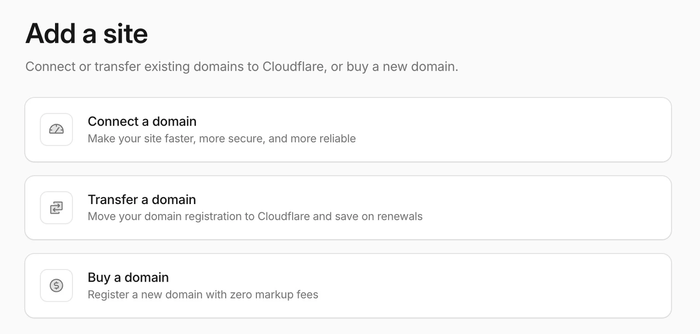
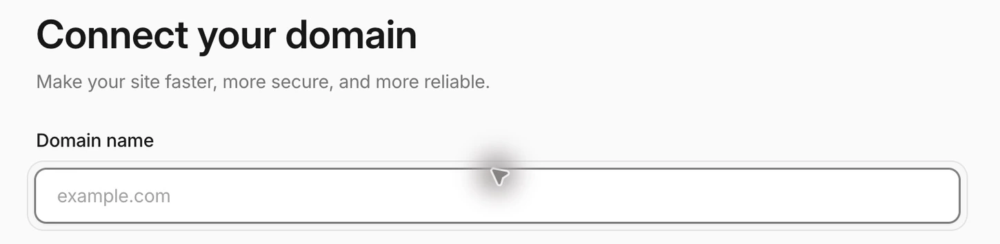

3. In Spaceship's domain manager, select the domain and open **Nameservers and DNS → Change → Custom nameservers**. Replace the current entries with the assigned pair, one hostname per field, and save. Return to **Domains → Overview** in Cloudflare and wait for **Active** before provisioning. To check the public delegation, run `dig +short NS example.org` with your domain and compare both names. [Spaceship nameserver settings](https://www.spaceship.com/knowledgebase/connect-domain-custom-nameservers/)

The following screenshots use an existing SingForge domain. We matched its registrar nameservers to the assigned Cloudflare pair and verified the zone was **Active**. The checkout candidate remains unregistered.

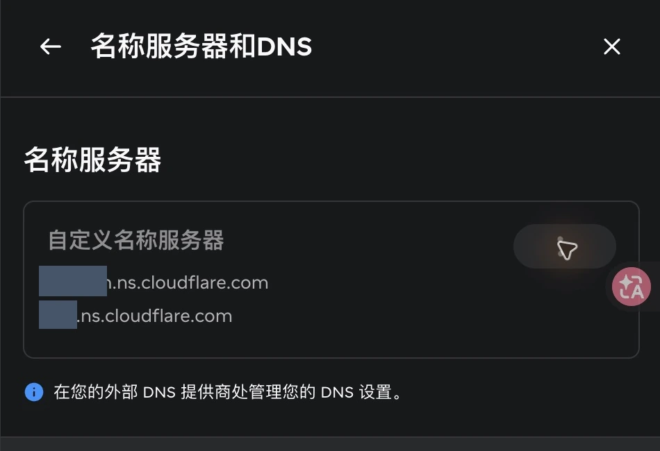

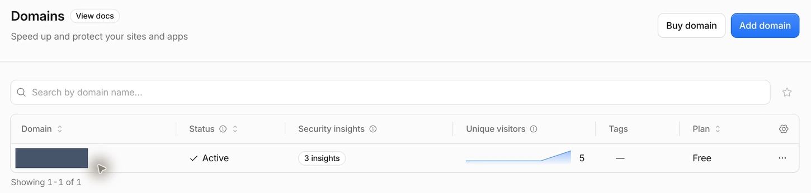

</details>

<details>
<summary><strong>3. Create a deployment token and a separate renewal token</strong></summary>

Open **My Profile → API Tokens → Create Token** and name the deployment token, for example `singforge-deploy`. [User API tokens](https://dash.cloudflare.com/profile/api-tokens)

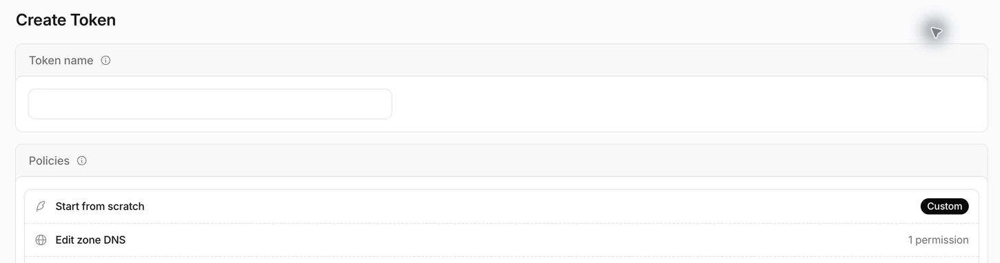

1. Choose **Start from scratch → Start with a Zone policy**. Set the resource to **Include → Specific zone → your domain**. Expand **DNS & Zones**. Select **Edit** on the **DNS** row and **Read** on the **Zone** row.
2. When enabling Tunnel, choose **Add new policy → Add new Account policy** and select the specific account that owns the zone. Search for `cloudflared` and select **Edit** on the **Cloudflare One Connector: cloudflared** row. This permission manages tunnels across the selected account.

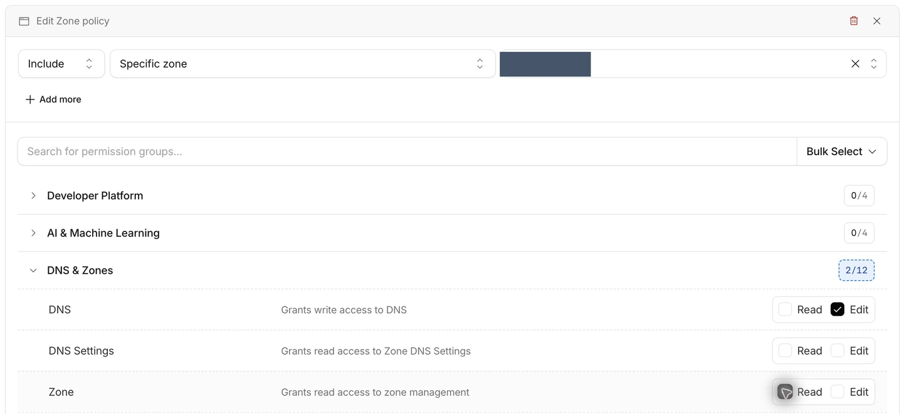
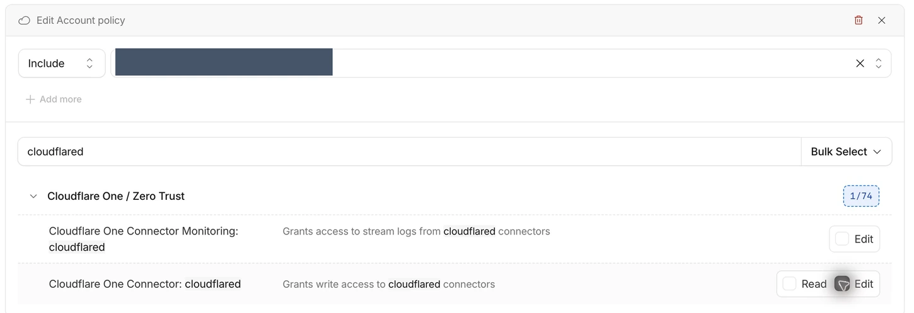

3. Choose an expiration and select **Continue to summary**. Check the domain, account, permissions and expiry before clicking **Create Token**. Save the one-time secret privately. Put the raw value in the VPS deployment file `cloudflare.token` shown below.
4. For HTTPS subscriptions, create another token with its own name, such as `singforge-renewal`. Choose **Edit zone DNS → Edit policy** and select the same **Specific zone**. The summary should list only **DNS: Edit**. Create the token and use this second secret in `certbot.ini`. Both demo tokens expire after seven days. For unattended renewal, choose a lifetime covering the next renewal or replace the secret in the file before expiry. [Cloudflare token creation](https://developers.cloudflare.com/fundamentals/api/get-started/create-token/)

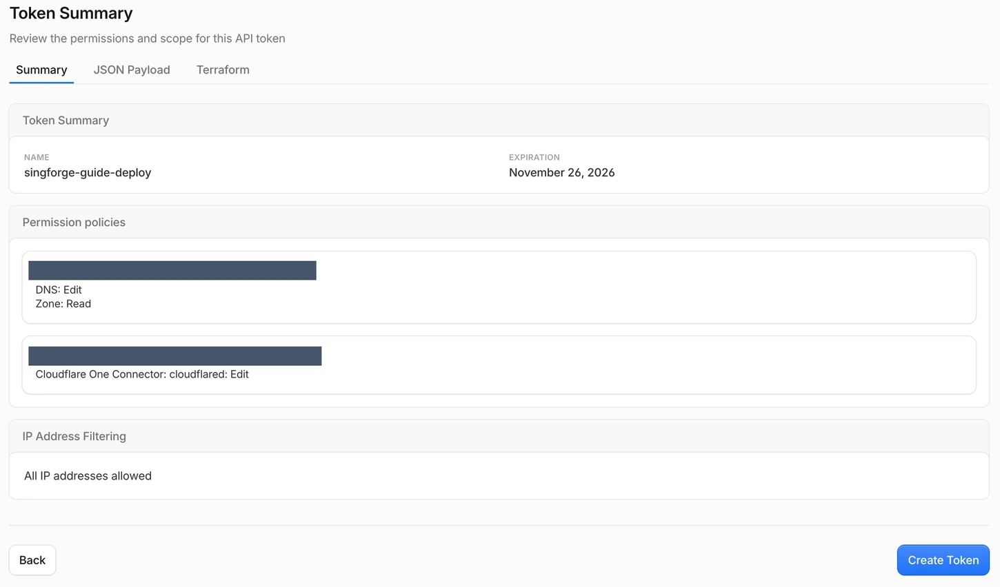
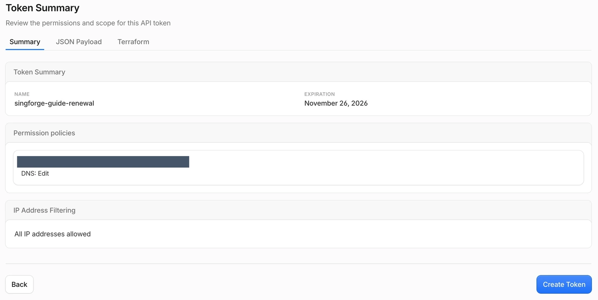
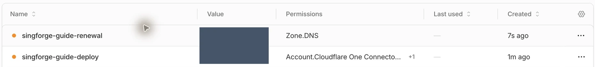

</details>

Install the dependencies on the VPS and fill in the private credential files. [Certbot DNS plugin](https://certbot-dns-cloudflare.readthedocs.io/en/stable/)

```sh
sudo apt-get update
sudo apt-get install -y nginx certbot python3-certbot-dns-cloudflare
sudo touch /root/singforge/cloudflare.token /root/singforge/certbot.ini
sudo chmod 600 /root/singforge/cloudflare.token /root/singforge/certbot.ini
sudoedit /root/singforge/cloudflare.token   # one line: raw management token
sudoedit /root/singforge/certbot.ini        # dns_cloudflare_api_token = RENEWAL_TOKEN
```

Edit the corresponding lines in the private `.env`. Credential fields point to root-owned private files. The parser reads literal values, rejects unknown keys and never evaluates shell commands.

```dotenv
PUBLIC_IP=203.0.113.10
DOMAIN=example.org
PREFIX=vps2
CF_API_TOKEN_FILE=/root/singforge/cloudflare.token
ENABLE_TUNNEL=true
ENABLE_SUBSCRIPTION=true
CERTBOT_CREDENTIALS_FILE=/root/singforge/certbot.ini
ACME_EMAIL=admin@example.org
ACME_AGREE_TOS=true
```

Replace the example IP, zone and email. Set `ACME_AGREE_TOS=true` after accepting the [Let's Encrypt subscriber agreement](https://letsencrypt.org/repository/). This example creates the following endpoints:

| Hostname | DNS | Purpose |
|---|---|---|
| `vps2-fast.example.org` | DNS-only A or AAAA | Direct protocols |
| `vps2-edge.example.org` | Proxied CNAME to a dedicated Tunnel | VLESS-WS and Trojan-WS |
| `vps2-sub.example.org` | DNS-only A or AAAA | HTTPS subscription |

## Apply and connect

Allow inbound TCP 8881 (Reality), UDP 8882 (Hysteria2), TCP/UDP 8892 (Shadowsocks) and TCP 443 for publication in the host firewall and cloud security group. Keep the SSH port allowed. The env template lets you change the three direct ports. Tunnel uses outbound TCP/UDP 7844. [Cloudflare firewall requirements](https://developers.cloudflare.com/cloudflare-one/networks/connectors/cloudflare-tunnel/configure-tunnels/tunnel-with-firewall/)

```sh
sudo singforge provision --env-file /root/singforge/.env --dry-run
sudo singforge provision --env-file /root/singforge/.env
sudo singforge doctor
sudo singforge
```

On the deployment host, preview and apply check the Cloudflare zone, enabled DNS names and tunnel before applying endpoints. Workspace previews show the offline plan. Matching DNS records are reused. An IP-only change patches the address of a managed record. A DNS write returning HTTP 409 is accepted only when a fresh lookup matches the requested configuration. For a reinstall, restore the matching tunnel credentials and DNS ownership ledger from a private backup. During apply, stderr shows the current stage and repeats it every 10 seconds with elapsed time. The final JSON plan goes to stdout. Apply checks DNS conflicts, registers the connector, obtains a DNS-01 certificate and configures renewal for the enabled features. Rerun the same file after an interruption. Existing credentials and subscription grants are retained.

For a private file export use `sudo singforge subscription show --format mihomo --output client.yaml`. For a published URL use `sudo singforge subscription issue --format mihomo` and save the URL privately when displayed. Import it in Clash Verge and test individual nodes under **Main**. The dashboard supports arrows or a number followed by Enter, and 0 to select Exit on the main menu.

In Smart routing, the AI-CN group defaults to DIRECT on fresh imports. Clients with a saved selection can choose DIRECT under AI-CN. International AI stays proxied and strict DNS keeps its encrypted proxy path.

## Development and releases

Run `make check` locally. Choose **Actions → Publish tagged release → Run workflow** on main and enter the next version, or push a tag. Pushing a semantic version tag such as `v0.1.1` starts the release workflow. GitHub verifies the code, tests a systemd lifecycle on Ubuntu, builds both Linux architectures and publishes binaries, installer, env template, SHA256SUMS and license notices. [Workflow](.github/workflows/release.yml) · [Validation](docs/validation.md) · [Security](docs/security.md)
