# SingForge

在单台 Linux VPS 上部署和管理 sing-box。命令行和数字菜单都支持直连 Reality、Hysteria2、Shadowsocks；可选 Cloudflare Named Tunnel 备用入口和 HTTPS 订阅。

[English](README.md) · [下载 Release](https://github.com/howardshaw/singforge/releases) · [命令索引](docs/cli.md) · [运维指南](docs/operations.md)

## 交给 Agent 安装

```text
先读 AGENTS.md。通过 SSH 登录 <目标主机>，使用 <私有 .env 路径> 安装最新版稳定 SingForge，按配置开通域名、Tunnel 和 HTTPS 订阅。保留已有服务和授权，验证后私下返回 Clash/Mihomo、Shadowsocks 和 v2rayN 的订阅地址。
```

## 在 VPS 安装正式版

准备 Debian 12+ 或 Ubuntu 22.04+、systemd、sudo/root 和 amd64 或 arm64。下面的命令在**新 VPS** 上运行，直接下载 GitHub Actions 构建的 CLI。安装核心还需能通过 HTTPS 访问上游发布站点。

```sh
VERSION=v0.1.4
BASE="https://github.com/howardshaw/singforge/releases/download/$VERSION"
SETUP=$(mktemp -d)
cd "$SETUP"
for file in install.sh singforge.env.example SHA256SUMS; do
  curl --proto '=https' --proto-redir '=https' -fSL "$BASE/$file" -o "$file" || exit 1
done
sha256sum -c --ignore-missing SHA256SUMS && sudo sh install.sh --release "$VERSION"
sudo install -d -m 700 /root/singforge
sudo install -m 600 singforge.env.example /root/singforge/.env  # 仅新机首次执行
sudoedit /root/singforge/.env
```

安装器自动选择架构，并用同一 GitHub Release 的 SHA-256 清单核对二进制。已有部署可用 `sudo singforge self update --yes` 更新 CLI。

## 填写 .env

**只有 VPS IP** 时，只填 `PUBLIC_IP`，云服务器经 NAT 时填公网映射地址。`DOMAIN` 留空，两个功能开关保留 false，直接进入「部署与连接」。

**需要域名、Tunnel 或 HTTPS 订阅时**，把已在 Cloudflare 激活的根域名填入 `DOMAIN`，每台 VPS 使用独立的 `PREFIX`。已有托管域名可以直接从第 3 步创建令牌。

<details>
<summary><strong>1. 在 Spaceship 搜索域名并核对付款金额</strong></summary>

在 [Spaceship](https://www.spaceship.com/) 的「注册」搜索框输入六位数字和候选后缀。对同一组数字比较各后缀的**注册价和续费价**。本次搜索的 54 个可购买报价中，`739462.xyz` 首年最低，注册和续费均显示 ¥4.47。可用性、币种和价格以你下单时的页面为准。

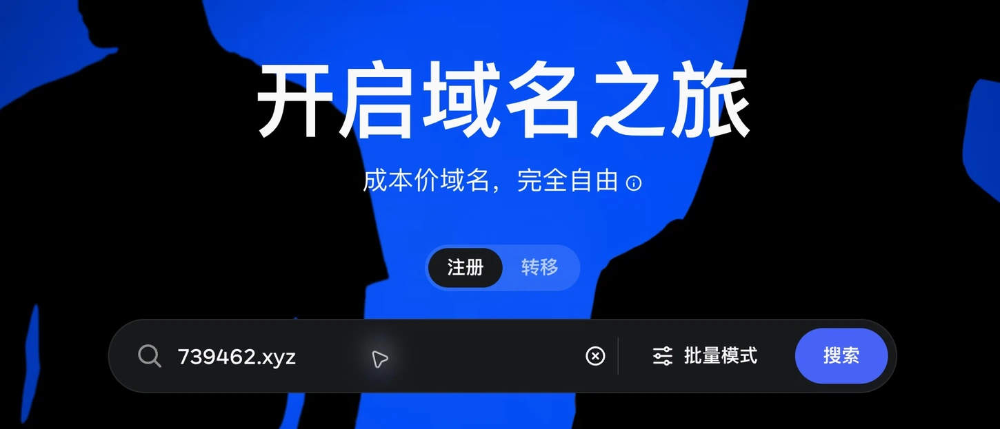
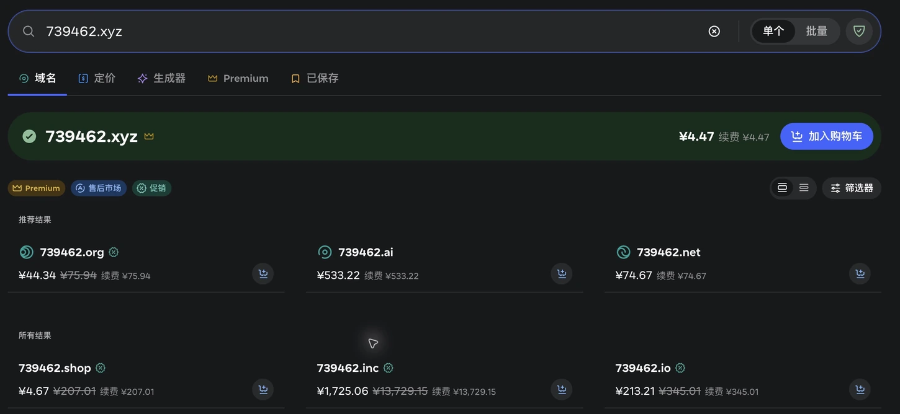

点击目标域名旁的「加入购物车」→「查看购物车」。若弹出产品推荐，点击「继续前往购物车」。本例只保留一年域名注册，购物车另列 ICANN 费用 ¥1.33。点击「结账」即可查看付款方式和含费总额 ¥5.80。**本次演示停在「立即支付」按钮前**；实际注册成功后，域名才会出现在你的域名管理器中。

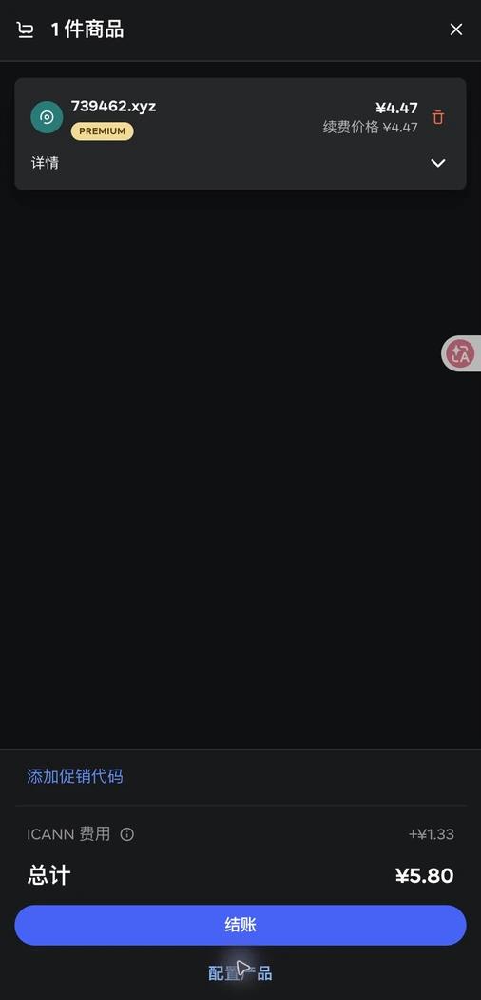 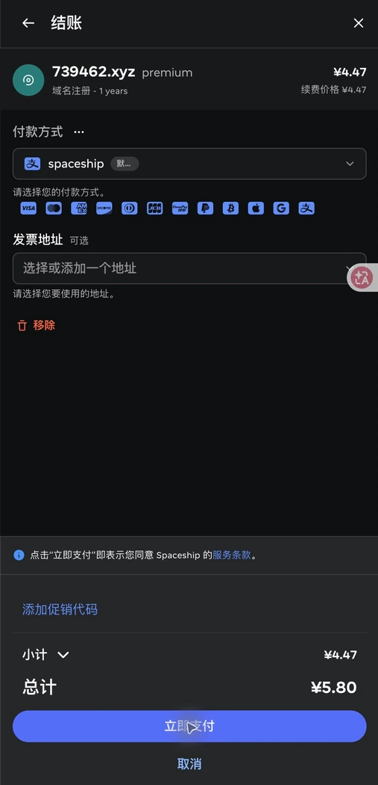

</details>

<details>
<summary><strong>2. 将已注册域名的 DNS 托管到 Cloudflare</strong></summary>

1. 登录 Cloudflare，打开 **Domains → Overview → Add domain → Connect a domain**。输入你已注册的根域名，例如 `example.org`。选择自动导入 DNS 记录，继续并选择 **Free** 套餐。
2. 在 DNS 记录核对页，对照旧 DNS 服务商补齐网站、邮件和验证记录，尤其是 MX、TXT。如果原来启用了 DNSSEC，先按迁移指引处理注册商的旧 DS 记录。复制 Cloudflare 为**这个域名**分配的两台名称服务器。[Cloudflare 域名接入](https://developers.cloudflare.com/dns/zone-setups/full-setup/setup/)

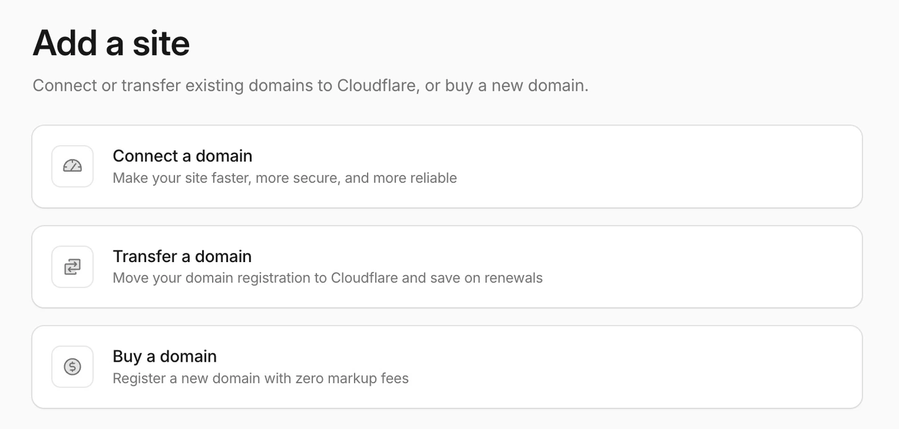
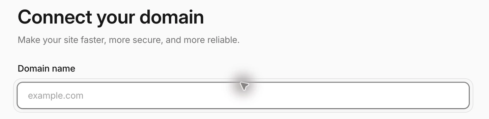

3. 回到 Spaceship 的「域名管理器」，选中域名 →「名称服务器和 DNS」→「更改」→「自定义名称服务器」。用刚复制的两个主机名替换原 NS，各填一行，保存。回到 Cloudflare 检查委派状态，等 **Domains → Overview** 显示 **Active** 后再部署。也可以运行 `dig +short NS example.org`（替换域名），核对公开查询是否返回同一对 NS。[Spaceship 名称服务器设置](https://www.spaceship.com/knowledgebase/connect-domain-custom-nameservers/)

下面两张图来自已有的 SingForge 域名。实操核对了注册商显示的两台 NS 与 Cloudflare 的分配值，并确认该 Zone 为 **Active**。付款页的候选域名尚未注册。

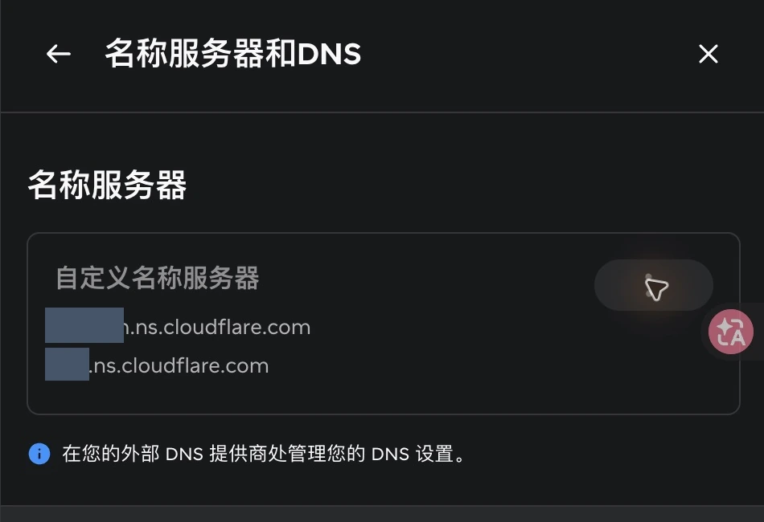

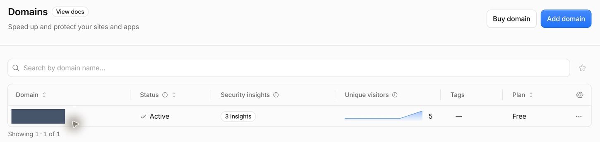

</details>

<details>
<summary><strong>3. 创建部署令牌和独立的证书续签令牌</strong></summary>

在 **My Profile → API Tokens → Create Token** 填写部署令牌名称，例如 `singforge-deploy`。[打开用户令牌页面](https://dash.cloudflare.com/profile/api-tokens)

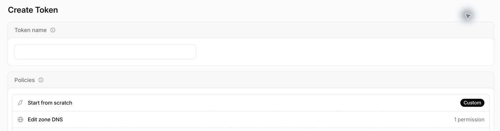

1. 选 **Start from scratch → Start with a Zone policy**。资源设为 **Include → Specific zone → 你的域名**。展开 **DNS & Zones**，在 **DNS** 行勾选 **Edit**，在 **Zone** 行勾选 **Read**。
2. 启用 Tunnel 时，点 **Add new policy → Add new Account policy**，选择域名所属的具体账户。搜索 `cloudflared`，在 **Cloudflare One Connector: cloudflared** 行勾选 **Edit**。这一项允许管理该账户的 Tunnel。

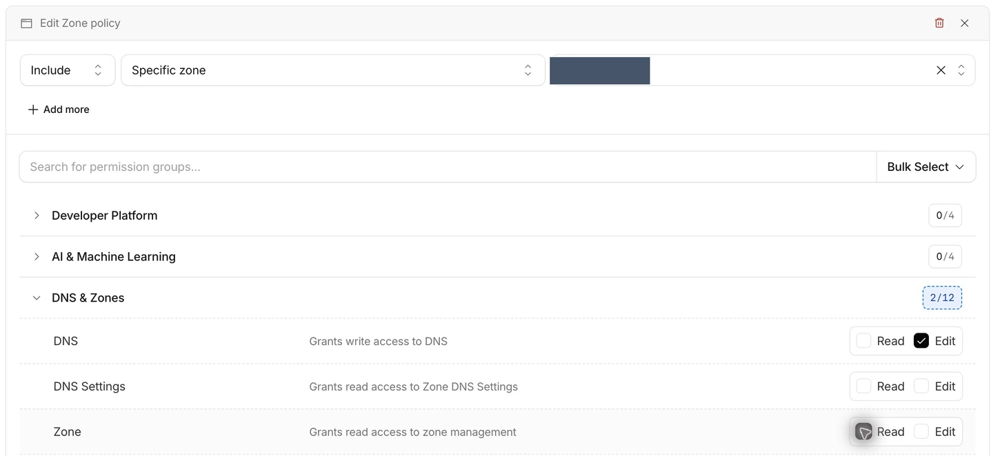
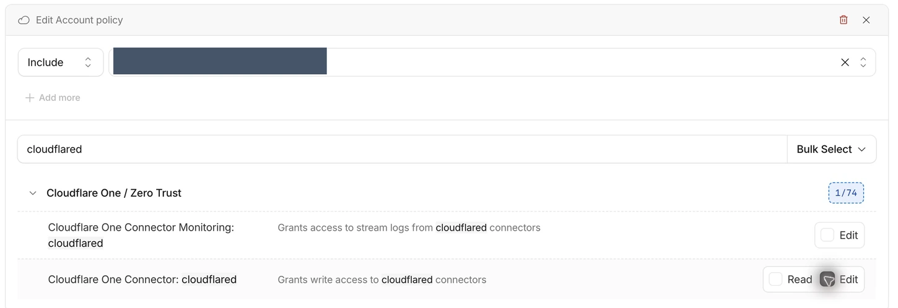

3. 选择有效期，点 **Continue to summary**。逐项核对域名、账户、权限和到期日，点击 **Create Token**。立即将只显示一次的密钥单独保存，部署时把原值写入下方的 `cloudflare.token`。
4. 启用 HTTPS 订阅时，再点 **Create Token**，另取名称（例如 `singforge-renewal`）。选择 **Edit zone DNS → Edit policy**，限定到同一 **Specific zone**。摘要应只列 **DNS: Edit**。创建后把这枚密钥写入 `certbot.ini`。演示令牌有效期均为 7 天；实际使用时让续签凭据覆盖下一次自动续签，或在到期前替换文件中的密钥。[Cloudflare 创建令牌](https://developers.cloudflare.com/fundamentals/api/get-started/create-token/)

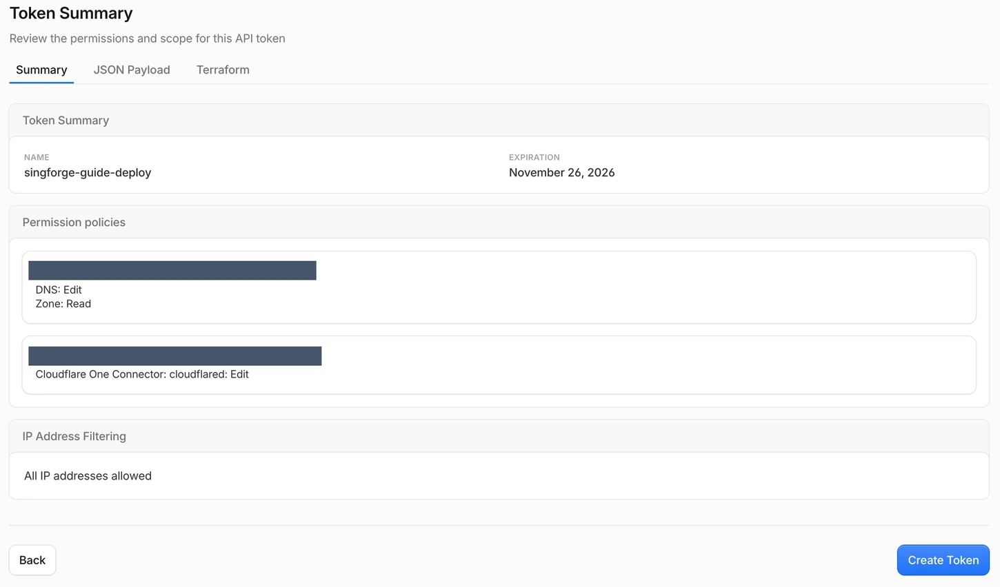
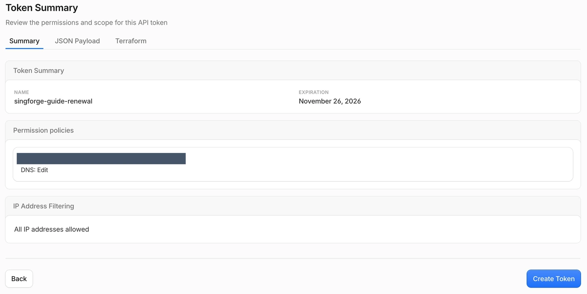
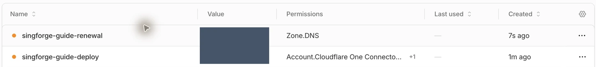

</details>

在 VPS 上安装依赖并填写私有凭据文件。[Certbot DNS 插件](https://certbot-dns-cloudflare.readthedocs.io/en/stable/)

```sh
sudo apt-get update
sudo apt-get install -y nginx certbot python3-certbot-dns-cloudflare
sudo touch /root/singforge/cloudflare.token /root/singforge/certbot.ini
sudo chmod 600 /root/singforge/cloudflare.token /root/singforge/certbot.ini
sudoedit /root/singforge/cloudflare.token   # 只填部署令牌本身，一行
sudoedit /root/singforge/certbot.ini        # dns_cloudflare_api_token = 续签令牌
```

编辑私有 `.env` 中对应的行；Token 通过文件路径引用。配置按字面值解析，未知字段会报错，不执行 shell 代码。

```dotenv
PUBLIC_IP=203.0.113.10
DOMAIN=example.org
PREFIX=vps2
CF_API_TOKEN_FILE=/root/singforge/cloudflare.token
ENABLE_TUNNEL=true
ENABLE_SUBSCRIPTION=true
CERTBOT_CREDENTIALS_FILE=/root/singforge/certbot.ini
ACME_EMAIL=admin@example.org
ACME_AGREE_TOS=true
```

替换示例 IP、根域名和邮箱。阅读并接受 [Let's Encrypt 订户协议](https://letsencrypt.org/repository/) 后再设置 `ACME_AGREE_TOS=true`。上述示例生成三个入口：

| 域名 | DNS | 用途 |
|---|---|---|
| `vps2-fast.example.org` | A 或 AAAA，DNS only | 协议直连 |
| `vps2-edge.example.org` | 指向独立 Tunnel 的 CNAME，Proxied | VLESS-WS、Trojan-WS |
| `vps2-sub.example.org` | A 或 AAAA，DNS only | HTTPS 订阅地址 |

## 部署与连接

在云安全组和主机防火墙放行入站 TCP 8881（Reality）、UDP 8882（Hysteria2）、TCP/UDP 8892（Shadowsocks）。启用订阅时放行 TCP 443，保留 SSH 端口。三个直连端口可以在模板中修改。Tunnel 使用出站 TCP/UDP 7844。[Cloudflare 防火墙要求](https://developers.cloudflare.com/cloudflare-one/networks/connectors/cloudflare-tunnel/configure-tunnels/tunnel-with-firewall/)

```sh
sudo singforge provision --env-file /root/singforge/.env --dry-run
sudo singforge provision --env-file /root/singforge/.env
sudo singforge doctor
sudo singforge
```

在部署主机上，预览和执行都会先核对 Cloudflare 区域、已启用的 DNS 名称和隧道，再应用入口配置。工作区预览仅显示离线计划。已有 DNS 记录完全匹配时直接复用；托管记录只有 IP 变化时只更新地址。DNS 写入返回 HTTP 409 后会重新查询，只有结果与目标配置一致才继续。重装时，如果同名本地管理隧道处于 down 或 inactive 状态，预览会显示 `recover_tunnel_id`。执行时使用部署 API 令牌恢复连接凭据，沿用原 Tunnel ID。在线隧道可从私密备份恢复凭据；需要修改已有托管记录的 IP 时可恢复 DNS 归属记录。执行时，进度写入标准错误；同一步骤持续超过 10 秒时，每 10 秒显示一次已用时间。最终的 JSON 计划写入标准输出。执行后按所选功能检查 DNS 冲突、创建并启动 Tunnel、通过 DNS-01 签发证书并配置自动续签。中断后可使用同一文件重试，已有节点凭据和订阅授权会保留。

离线导出使用 `sudo singforge subscription show --format mihomo --output client.yaml`。启用发布后，执行 `sudo singforge subscription issue --format mihomo` 并私下保存显示的 URL。在 Clash Verge 导入后可在 **Main** 中逐个测速、选节点。主菜单支持方向键或数字加 Enter，输入 0 可选中退出。

Smart 路由下，国内 AI 域名匹配 `AI-CN`，首次导入默认选择 `DIRECT`（客户端本地直连）。已保存分组选择的客户端可在「代理 → AI-CN」手动切换到 DIRECT。国际 AI 保持代理，严格模式的 DNS 仍通过加密代理路径解析。

在完整 Mihomo 订阅的规则模式下，可在「代理 → Unmatched」选择 `Main`（跟随默认代理）或 `DIRECT`（直连）。Smart、Global、Custom 首次使用默认选 Main，GFW-only 默认选 DIRECT。只有前面所有规则都未命中的连接才会进入该组。Smart 按顺序匹配用户覆盖、内置服务规则、GeoSite 国际和国内 AI 分类、通用平台规则及中国域名/IP。客户端每 24 小时更新地理库；分类库收录的新 AI 站点可自动进入对应分组。Smart 路由搭配 split 或 domestic-first 时，普通国内网站由同一个 CN 域名集合选择 AliDNS 和直连出口。严格模式仅用该集合分流连接。

[完整 Mihomo 分流示例](examples/mihomo-smart-split.yaml) 由 CLI 使用测试节点生成，可用于核对 DNS 上游、策略顺序和代理分组。

可选的国内网络模式通过 `sudo singforge dns set --mihomo-policy domestic-first` 启用。它用国内加密 IP 引导 DNS；内置国内 AI 的 DNS 连接跟随 `AI-CN` 选择。未命中国内 DNS 策略的站点即使业务直连，也经 `Main` 或 `AI` 查询加密 DNS，代理断开时未缓存的查询会失败。Smart 模式中，已收录的通用海外域名走 `Main`。

## 开发与发版

本地检查使用 `make check`。在 GitHub 的 **Actions → Publish tagged release → Run workflow** 中选择 main 并填写新版本号，即可由 CI 打标签和发布。也可以推送形如 `v0.1.1` 的语义版本标签即触发发布。GitHub 在 Ubuntu 上验证代码和 systemd 生命周期，构建两个 Linux 架构，并发布二进制、安装器、env 模板、SHA256SUMS 和许可证。[发布工作流](.github/workflows/release.yml) · [测试说明](docs/validation.md) · [安全说明](docs/security.md)
