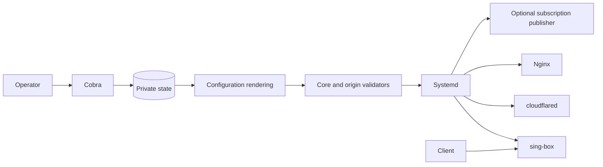
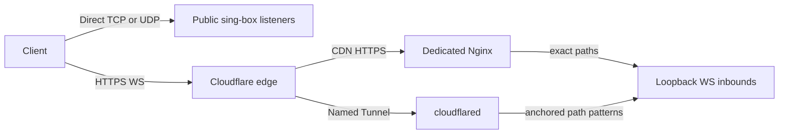
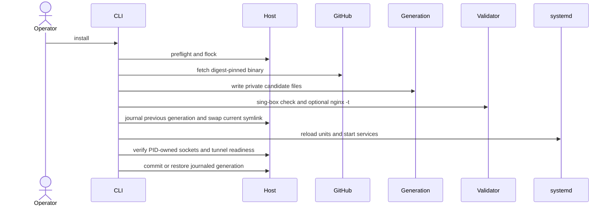
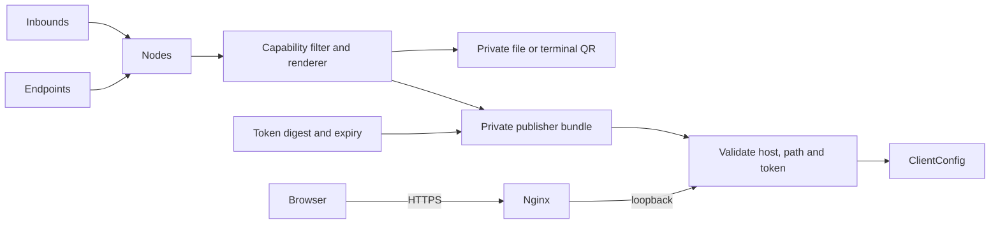
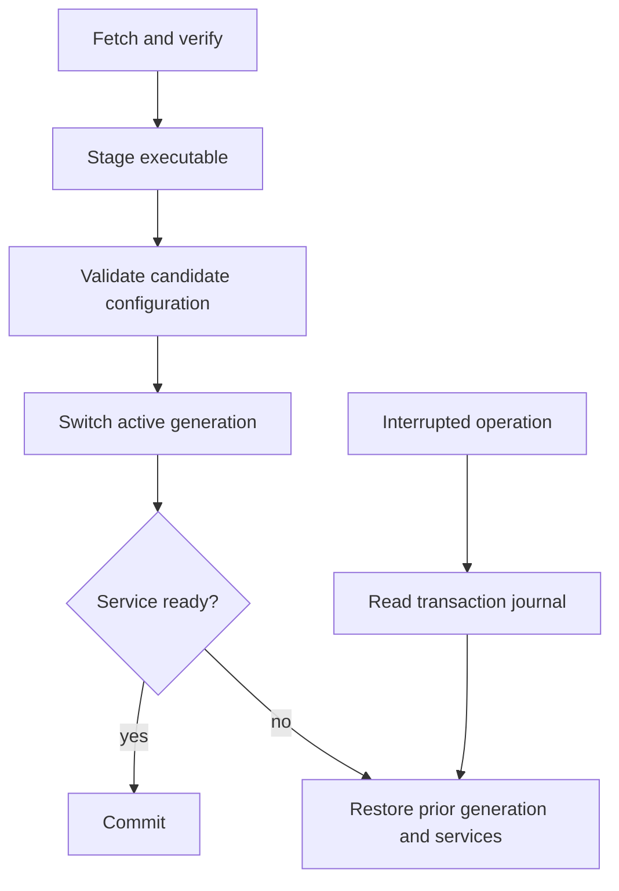
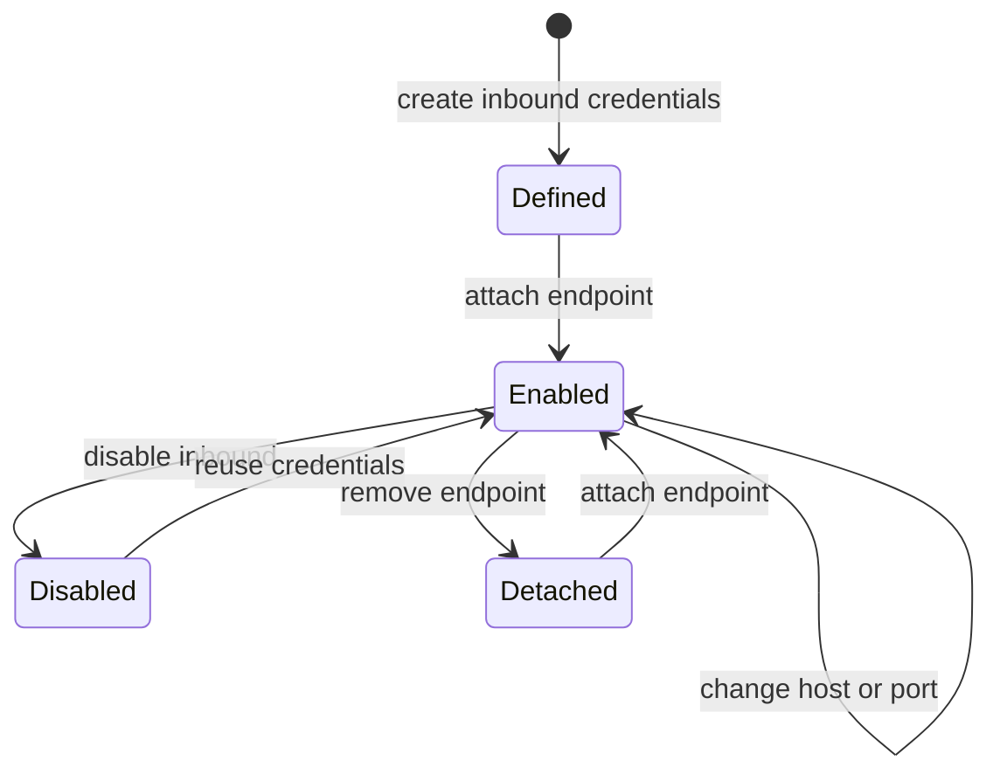

# Architecture

The executable enters through `cmd/singforge/main.go`. The Cobra tree in `internal/cli/root.go` attaches each leaf to an operation. Host operations take an exclusive file lock. The private JSON state carries a schema version, protocol credentials, endpoint references and routing policy.

## Access modes

## Installation

## Subscriptions

The publisher receives rendered exports and grant hashes over a systemd-opened input file. It needs neither the deployment lock nor read access to server private keys.

## Update and rollback

## Endpoint lifecycle

`internal/model` owns these relations. `internal/render` produces native client and server shapes. `internal/cloudflare` handles API reconciliation. `internal/host` owns generated services, binaries, readiness and rollback. `internal/store` implements locking, atomic file replacement and portable state backup.
